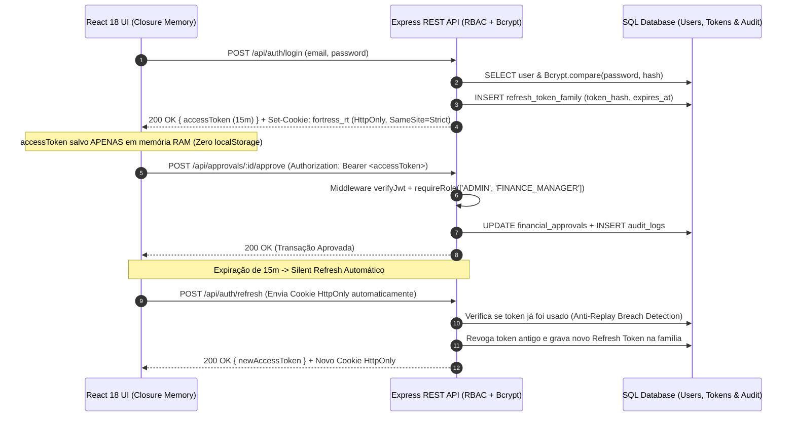

# Fortress JWT & RBAC Vault 🏰🔐

[](https://www.typescriptlang.org/)
[](https://react.dev/)
[](https://nodejs.org/)
[](https://owasp.org/)
[](https://www.w3.org/WAI/WCAG21/quickref/)

**Cofre Full-Stack de Autenticação Zero-Trust e Governança de Alçadas Financeiras (RBAC)** construído com **Node.js, Express, TypeScript, SQL (SQLite), React 18, Vite, Tailwind CSS, shadcn/ui e Framer Motion**.

---

## 🎯 O Problema Real de Mercado Resolvido

Mais de 90% das aplicações SPA modernas cometem um erro crítico de segurança: **armazenam o token JWT no `localStorage` ou `sessionStorage` do navegador**. Caso ocorra qualquer vulnerabilidade de *Cross-Site Scripting (XSS)* — até mesmo via pacote NPM de terceiros — um atacante consegue ler `localStorage.getItem('token')` e sequestrar a conta do executivo.

O **Fortress JWT & RBAC Vault** elimina esse vetor de ataque de ponta a ponta:

1. **JWT de Curta Duração Exclusivamente em Memória (`In-Memory Access Token`):**
   No Front-End React, o `accessToken` (15 minutos) vive **apenas em uma variável privada dentro de um Closure/Contexto em memória RAM**, jamais tocando no `localStorage`, `sessionStorage` ou cookies acessíveis via `document.cookie`.
2. **Refresh Token Rotativo em Cookie `HttpOnly` + Detecção de Roubo de Sessão:**
   O `refreshToken` (7 dias) é transmitido exclusivamente via cabeçalho `Set-Cookie` com as flags `HttpOnly; Secure; SameSite=Strict; Path=/api/auth`. A cada renovação silenciosa (*Silent Refresh*), o token antigo é invalidado no banco SQL e substituído por um novo (**Refresh Token Rotation**). Se um token antigo for reutilizado, o sistema detecta o sequestro e revoga toda a família de sessões do usuário imediatamente.
3. **Senhas com `Bcrypt` & Controle de Acesso Baseado em Cargos (`RBAC`):**
   Hashing adaptativo com **Bcrypt** e matriz de permissões granular (`ADMIN`, `FINANCE_MANAGER`, `AUDITOR`) validada tanto no middleware da API RESTful quanto na renderização condicional da UI.
4. **Acessibilidade Nativa (`WCAG 2.1 Nível AA`):**
   Interface desenhada com **Tailwind CSS + padrões shadcn/ui + Framer Motion** respeitando `prefers-reduced-motion`, navegação integral por teclado (`Skip to main content`, `Focus Visible`, `aria-live="polite"`, `role="alert"` e contraste mínimo de `4.5:1`).

---

## 🏗️ Arquitetura de Segurança Zero-Trust



---

## 📂 Estrutura do Projeto

```text
fortress-jwt-rbac/
├── server/
│   ├── src/
│   │   ├── config/
│   │   │   └── database.ts            # Camada SQL (SQLite Nativo) com tabelas users, refresh_tokens, approvals e audit_logs
│   │   ├── middleware/
│   │   │   ├── authMiddleware.ts      # Validação estrita do Bearer JWT
│   │   │   └── rbacMiddleware.ts      # Guarda de rotas por Role e Permission (RBAC)
│   │   ├── services/
│   │   │   ├── AuthService.ts         # Bcrypt, emissão JWT, rotação de Refresh Token e revogação de família
│   │   │   └── ApprovalVaultService.ts # Fluxo de alçadas financeiras e trilha de auditoria SQL
│   │   ├── routes/
│   │   │   └── apiRoutes.ts           # Endpoints RESTful (/api/auth/*, /api/approvals/*, /api/audit)
│   │   ├── types/
│   │   │   └── domain.ts              # Contratos TypeScript de RBAC, JWT e Entidades
│   │   └── index.ts                   # Bootstrap Express + Helmet + CORS Credentials + CookieParser
│   └── tests/
│       └── authAndRbac.test.ts        # Suíte de testes automatizados (Bcrypt, JWT, Rotação e RBAC)
├── client/
│   ├── src/
│   │   ├── context/
│   │   │   └── AuthMemoryContext.tsx  # Guarda o Access Token estritamente em memória RAM + Silent Refresh
│   │   ├── components/
│   │   │   ├── ui/                    # Componentes acessíveis padrão shadcn/ui (Button, Badge, Card, Alert)
│   │   │   ├── RbacGuard.tsx          # Proteção visual declarativa por Role/Permissão
│   │   │   └── VaultDashboard.tsx     # Painel WCAG 2.1 AA com animações Framer Motion
│   │   ├── App.tsx
│   │   └── main.tsx
├── docker-compose.yml
├── Dockerfile
├── vercel.json
└── package.json
```

---

## 🚀 Como Executar Localmente ou com Docker

### 1. Instalação e Testes Automatizados
```bash
git clone https://github.com/JzGuilherme/fortress-jwt-rbac.git
cd fortress-jwt-rbac
cp .env.example .env
npm install
npm test
```

### 2. Rodando Back-End e Front-End
```bash
# Terminal 1: API RESTful Node.js + Express (Porta 4000)
npm run dev:server

# Terminal 2: Front-End React + Vite + Tailwind (Porta 5173)
npm run dev:client
```

---

## 📄 Licença

Distribuído sob a licença **MIT**. Veja [LICENSE](LICENSE) para mais detalhes.
