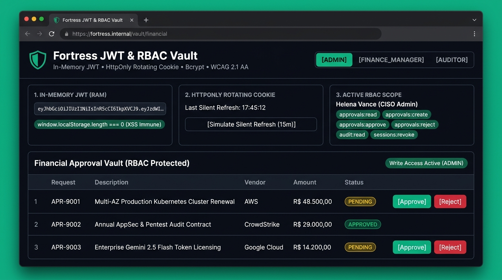
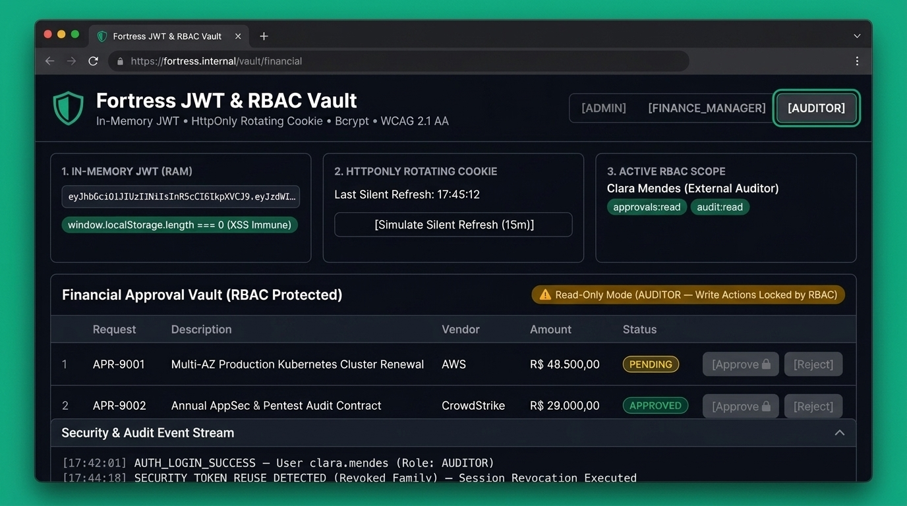
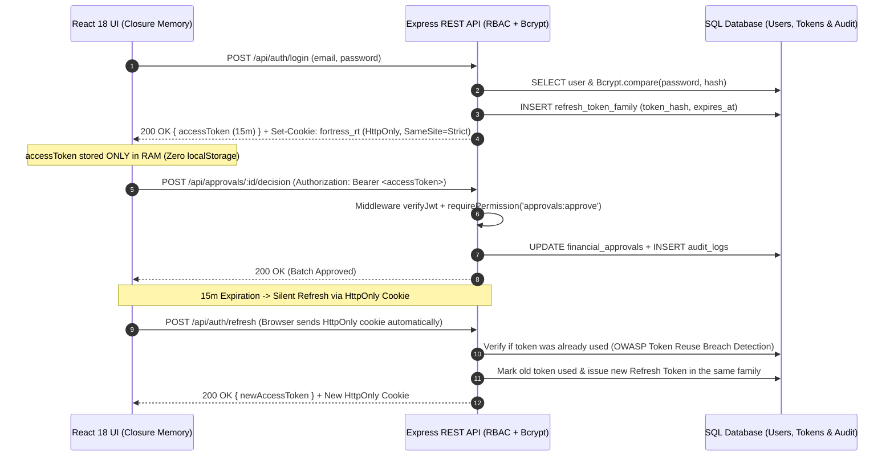

# Fortress JWT & RBAC Vault 🏰🔐

[](https://www.typescriptlang.org/)
[](https://react.dev/)
[](https://nodejs.org/)
[](https://owasp.org/)
[](https://www.w3.org/WAI/WCAG21/quickref/)

**Full-Stack Zero-Trust Access & Financial Approval Vault** engineered with **Node.js, Express, TypeScript, SQL (SQLite), React 18, Vite, Tailwind CSS, shadcn/ui, and Framer Motion**.

---

## 🖥️ Live UI Preview & Accessibility Showcase

### 1. CISO Admin View — In-Memory JWT Telemetry & Full RBAC Write Access
The `ADMIN` and `FINANCE_MANAGER` roles hold the `approvals:approve` and `approvals:reject` permissions, unlocking write actions on high-value FinOps batches while keeping `window.localStorage` completely empty (`length === 0`):



### 2. External Auditor View — RBAC Read-Only Enforcement, WCAG Focus Ring & Breach Audit Trail
Switching to the `AUDITOR` role dynamically restricts the session scope to `approvals:read` and `audit:read`. Write actions are locked both in the UI and at the Express REST middleware layer, while full keyboard focus rings (`3px solid #10B981`) and `aria-live` regions guarantee **WCAG 2.1 AA** compliance:



---

## 🎯 The Real-World Security Problem Solved

Over 90% of modern Single-Page Applications (SPAs) suffer from a critical architectural flaw: **storing JWT tokens inside `localStorage` or `sessionStorage`**. If any Cross-Site Scripting (XSS) vector occurs — even through a compromised third-party NPM dependency — an attacker can execute `localStorage.getItem('token')` and exfiltrate executive credentials instantly.

**Fortress JWT & RBAC Vault** eliminates this attack surface end-to-end:

1. **Short-Lived JWT Strictly in RAM (`In-Memory Closure`):**
   On the React client (`AuthMemoryContext.tsx`), the 15-minute `accessToken` lives **exclusively inside a private JavaScript closure in memory**, never touching `localStorage`, `sessionStorage`, or DOM-accessible cookies.
2. **Rotating Refresh Tokens in `HttpOnly` Cookies + Reuse Breach Detection:**
   The 7-day `refreshToken` is transmitted strictly via `Set-Cookie` with `HttpOnly; Secure; SameSite=Strict; Path=/api/auth`. On every silent refresh (`/api/auth/refresh`), the previous token is marked as used and replaced. If an attacker replays an already-rotated token, the backend detects the breach (`TOKEN_REUSE_BREACH_DETECTED`), revokes the entire token family in SQL, and logs a critical security event.
3. **Adaptive `Bcrypt` Hashing & Granular `RBAC` Matrix:**
   Passwords are hashed using **Bcrypt**, and every endpoint is guarded by declarative role and permission middleware (`ADMIN`, `FINANCE_MANAGER`, `AUDITOR`).
4. **Native `WCAG 2.1 Level AA` Accessibility:**
   Built with **Tailwind CSS + shadcn/ui patterns + Framer Motion** (`useReducedMotion`), featuring a keyboard Skip-Link, high-contrast focus rings, semantic ARIA states (`aria-pressed`, `aria-live="polite"`), and screen-reader announcements.

---

## 🏗️ Zero-Trust Authentication & RBAC Sequence



---

## 🔐 RBAC Permission Matrix

| Permission Slug | `ADMIN` (CISO) | `FINANCE_MANAGER` (FinOps) | `AUDITOR` (Compliance) |
| :--- | :---: | :---: | :---: |
| `approvals:read` | ✅ | ✅ | ✅ |
| `approvals:create` | ✅ | ✅ | ❌ |
| `approvals:approve` | ✅ | ✅ | ❌ |
| `approvals:reject` | ✅ | ✅ | ❌ |
| `audit:read` | ✅ | ✅ | ✅ |
| `sessions:revoke` | ✅ | ❌ | ❌ |

---

## 📂 Project Architecture

```text
fortress-jwt-rbac/
├── docs/
│   └── screenshots/
│       ├── dashboard-admin-view.jpg
│       └── dashboard-auditor-readonly-wcag.jpg
├── server/
│   ├── src/
│   │   ├── config/
│   │   │   └── database.ts            # Relational SQLite layer (users, refresh_tokens, approvals, audit_logs)
│   │   ├── middleware/
│   │   │   └── rbacMiddleware.ts      # Bearer JWT verification + Role & Permission guards
│   │   ├── services/
│   │   │   └── AuthService.ts         # Bcrypt verification, JWT issuer & Refresh Token reuse detection
│   │   ├── routes/
│   │   │   └── apiRoutes.ts           # Express RESTful endpoints (/api/auth/*, /api/approvals/*, /api/audit-logs)
│   │   ├── types/
│   │   │   └── domain.ts              # Strict TypeScript RBAC & domain contracts
│   │   └── index.ts                   # Express bootstrap + Helmet + CORS Credentials + CookieParser
│   └── tests/
│       └── authAndRbac.test.ts        # Automated Node 22 test suite (Bcrypt, Token Rotation Breach & RBAC)
├── client/
│   ├── src/
│   │   ├── context/
│   │   │   └── AuthMemoryContext.tsx  # Private RAM closure storing Access Token + Silent Refresh simulator
│   │   ├── components/
│   │   │   ├── ui/
│   │   │   │   └── Primitives.tsx     # Accessible shadcn/ui-style Button & Badge primitives
│   │   │   └── VaultDashboard.tsx     # WCAG 2.1 AA interactive FinOps & RBAC dashboard with Framer Motion
│   │   ├── App.tsx
│   │   └── main.tsx
├── docker-compose.yml
├── Dockerfile
├── vercel.json
└── package.json
```

---

## 🚀 Getting Started (Local & Docker)

### 1. Clone, Install & Run Automated Tests
```bash
git clone https://github.com/JzGuilherme/fortress-jwt-rbac.git
cd fortress-jwt-rbac
cp .env.example .env
npm install
npm test
npm run typecheck
```

### 2. Start Full-Stack Development Servers
```bash
# Terminal 1: Node.js + Express Zero-Trust REST API (http://localhost:4000)
npm run dev:server

# Terminal 2: React 18 + Vite + Tailwind CSS UI (http://localhost:5173)
npm run dev:client
```

### 3. Run via Docker Compose
```bash
docker compose up -d --build
```

---

## 📄 License

Distributed under the **MIT License**. See [LICENSE](LICENSE) for full details.
